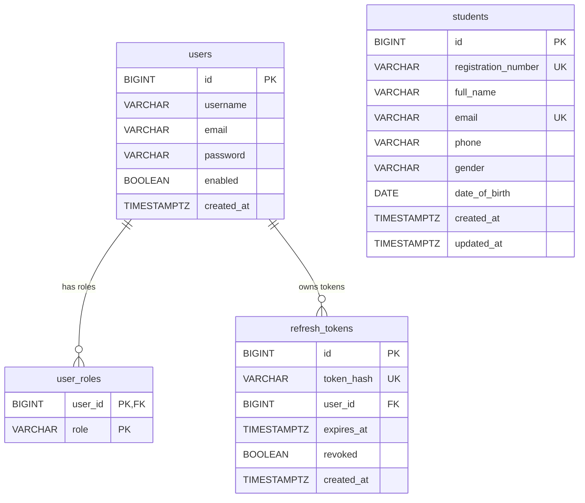

# Secure Student Management API

A Spring Boot REST API for student records, user accounts, role-based access, and token authentication.

## Table of contents

1. [Project description](#1-project-description)
2. [Technologies](#2-technologies)
3. [Prerequisites](#3-prerequisites)
4. [Database configuration](#4-database-configuration)
5. [Setup and run instructions](#5-setup-and-run-instructions)
6. [Configuration reference](#6-configuration-reference)
7. [Endpoint list](#7-endpoint-list)
8. [Authentication instructions](#8-authentication-instructions)
9. [Roles and permissions](#9-roles-and-permissions)
10. [Token strategy](#10-token-strategy-access-vs-refresh-rotation-and-logout)
11. [CORS configuration](#11-cors-configuration)
12. [CSRF configuration](#12-csrf-configuration)
13. [Error handling](#13-error-handling)
14. [Postman testing](#14-postman-testing)
15. [ERD](#15-erd)
16. [Project structure](#16-project-structure)
17. [Short explanations for the demonstration](#17-short-explanations-for-the-demonstration)
18. [Git and security notes](#18-git-and-security-notes)

## 1. Project description

The API manages student records and user accounts through a REST interface. It provides authentication and role checks so that student and user operations are available only to permitted callers.

The application uses a layered design:

```text
HTTP request
    |
    v
Controller -> Service -> Repository -> PostgreSQL
    |             |           |
    +-------------+-----------+---- response / error
```

Controllers handle HTTP routes and validation. Services implement application rules, repositories use Spring Data JPA, and PostgreSQL stores the data. Flyway owns schema creation.

## 2. Technologies

| Technology | Version in this project |
| --- | --- |
| Java | 21 (`java.version` in `pom.xml`) |
| Spring Boot | 4.1.1 (parent version in `pom.xml`) |
| Spring Security | Spring Boot 4.1.1-managed; not pinned separately |
| Spring Data JPA | Spring Boot 4.1.1-managed; not pinned separately |
| Flyway | Spring Boot starter and PostgreSQL database module; versions are managed by Spring Boot |
| PostgreSQL | Runtime JDBC driver is declared; server and driver versions are not explicitly pinned in `pom.xml` |
| JJWT | 0.12.6 |
| Lombok | Spring Boot-managed; version is not pinned separately |
| Maven | 3.9.16 through the Maven Wrapper distribution |
| Postman | Not declared in `pom.xml`; use a compatible Postman desktop app or CLI |

Spring Boot manages versions for dependencies that do not declare their own version in the project POM.

## 3. Prerequisites

| Requirement | Version / verification |
| --- | --- |
| Java Development Kit | Java 21. Verify with `java -version`. |
| Maven | Maven Wrapper is included. Verify with `./mvnw -version`. A local Maven install is optional. |
| PostgreSQL | A local PostgreSQL server and client. Verify the client with `psql --version`. |
| Postman | Postman desktop app or CLI. If the CLI is installed, verify with `postman --version`; otherwise use **Help > About** in the desktop app. |
| Git | Verify with `git --version`. |

On Windows, use `mvnw.cmd -version` and `mvnw.cmd spring-boot:run` from Command Prompt or PowerShell. PostgreSQL, Postman, and Git version checks are otherwise the same.

## 4. Database configuration

The application connects to a PostgreSQL database named `studentmanagement` on `localhost:5432` by default. Create it using `psql`:

```sh
psql -U postgres -d postgres -c "CREATE DATABASE studentmanagement;"
```

Set these datasource properties to match your local database. Do not use a real password in this README or commit it to source control.

| Property | Development default / value to set |
| --- | --- |
| `spring.datasource.url` | `jdbc:postgresql://localhost:5432/studentmanagement` |
| `spring.datasource.username` | `postgres` |
| `spring.datasource.password` | Set locally to `<your-postgres-password>`. |

For Linux/macOS, supply the password for the current shell before starting the app:

```sh
export SPRING_DATASOURCE_PASSWORD='<your-postgres-password>'
```

PowerShell equivalent:

```powershell
$env:SPRING_DATASOURCE_PASSWORD = '<your-postgres-password>'
```

Alternatively, set `spring.datasource.password` in your local `application.properties`; do not commit a real credential.

Flyway runs the migration on startup. Hibernate uses `spring.jpa.hibernate.ddl-auto=validate`, so it checks the schema but does not create or modify it. The migration at `src/main/resources/db/migration/V1__init.sql` creates `users`, `user_roles`, `refresh_tokens`, and `students`.

## 5. Setup and run instructions

Clone the repository and enter its directory:

```sh
git clone https://github.com/mygayustard/secure-student-manament.git secure-student-management
cd secure-student-management
```

Configure PostgreSQL as described above, then start the application:

```sh
./mvnw spring-boot:run
```

The API listens at `http://localhost:8080`. Startup is successful when the console reports that `StudentmanagementApplication` has started. A protected route can also confirm the server is responding; without a token, an HTTP `401` is expected:

```sh
curl -i http://localhost:8080/api/users/me
```

Tests exist under `src/test/java`. Run them with:

```sh
./mvnw test
```

On Windows, use `mvnw.cmd spring-boot:run` and `mvnw.cmd test`.

### Troubleshooting

| Problem | Meaning and fix |
| --- | --- |
| `password authentication failed` | PostgreSQL rejected the configured username/password. Check the local database credentials and set `SPRING_DATASOURCE_PASSWORD` or `spring.datasource.password` correctly. |
| Port 8080 is in use | Another process is listening on the configured port. Stop that process or change `server.port` in `application.properties`. |
| Database does not exist | PostgreSQL cannot find `studentmanagement`. Create it with the `CREATE DATABASE` command above and verify the JDBC URL. |
| JWT secret too short | Startup rejects `jwt.secret` values shorter than 32 UTF-8 bytes (256 bits). Configure a secret with at least 32 bytes and replace the development value outside development. |

## 6. Configuration reference

These custom application properties are defined in `src/main/resources/application.properties` and consumed by the application.

| Property | Meaning | Development default |
| --- | --- | --- |
| `jwt.secret` | HMAC key used to sign and verify access JWTs. Must be at least 32 UTF-8 bytes. | A development-only value is present in local configuration; it is intentionally not reproduced here. |
| `jwt.access-expiration-ms` | Access-token lifetime in milliseconds. | `900000` (15 minutes) |
| `jwt.refresh-expiration-ms` | Refresh-token lifetime in milliseconds. | `604800000` (7 days) |
| `app.cors.allowed-origin` | The single allowed browser origin. | `http://localhost:3000` |
| `app.seed.admin.username` | Seeded administrator username. | `admin` |
| `app.seed.admin.email` | Seeded administrator email. | `admin@example.com` |
| `app.seed.admin.password` | Seeded administrator password. | Configured in local properties; not reproduced here. |
| `app.seed.teacher.username` | Seeded teacher username. | `teacher` |
| `app.seed.teacher.email` | Seeded teacher email. | `teacher@example.com` |
| `app.seed.teacher.password` | Seeded teacher password. | Configured in local properties; not reproduced here. |

Replace the development JWT key and seeded credentials before deployment. Use an environment variable such as `JWT_SECRET` for the signing key rather than committing a production secret.

## 7. Endpoint list

All endpoints consume and return JSON unless noted. Protected endpoints require an access token in the `Authorization` header. The `fieldErrors` member is `null` except for validation failures.

| Method | Path | Required role / access | Request body fields | Success | Error statuses |
| --- | --- | --- | --- | --- | --- |
| `POST` | `/api/auth/register` | Public | `username`, `email`, `password` | `201` | `400`, `409`, `500` |
| `POST` | `/api/auth/login` | Public | `username`, `password` | `200` | `400`, `401`, `500` |
| `POST` | `/api/auth/refresh` | Public | `refreshToken` | `200` | `400`, `401`, `500` |
| `POST` | `/api/auth/logout` | Public | `refreshToken` | `200` | `400`, `500` |
| `GET` | `/api/students` | `ADMIN`, `TEACHER`, `STUDENT` | None | `200` | `401`, `403`, `500` |
| `GET` | `/api/students/{id}` | `ADMIN`, `TEACHER`, `STUDENT` | None | `200` | `401`, `403`, `404`, `500` |
| `POST` | `/api/students` | `ADMIN`, `TEACHER` | `registrationNumber`, `fullName`, `email`, `phone`, `gender`, `dateOfBirth` | `201` | `400`, `401`, `403`, `409`, `500` |
| `PUT` | `/api/students/{id}` | `ADMIN`, `TEACHER` | Same fields as student creation | `200` | `400`, `401`, `403`, `404`, `409`, `500` |
| `DELETE` | `/api/students/{id}` | `ADMIN` | None | `204` (no body) | `401`, `403`, `404`, `500` |
| `GET` | `/api/users` | `ADMIN` | None | `200` | `401`, `403`, `500` |
| `GET` | `/api/users/me` | Any authenticated user | None | `200` | `401`, `404`, `500` |

Registration requires a username of 3–50 characters, a valid email, and a password of at least 8 characters containing at least one letter and one digit. It always assigns `STUDENT`.

Student creation and update require a registration number (maximum 30 characters), full name (2–100 characters), valid email, gender (`MALE`, `FEMALE`, or `OTHER`), and a past `dateOfBirth`. The phone field may be blank or null; if provided, it must be an international number such as `+255712345678` or a 10-digit local number starting with `0`.

### Register

Request:

```json
{
  "username": "neema.mushi",
  "email": "neema.mushi@example.com",
  "password": "NeemaPass2026"
}
```

Response (`201 Created`):

```json
{
  "id": 101,
  "username": "neema.mushi",
  "email": "neema.mushi@example.com",
  "roles": ["STUDENT"],
  "createdAt": "2026-10-09T07:00:00Z"
}
```

### Login

Request:

```json
{
  "username": "neema.mushi",
  "password": "NeemaPass2026"
}
```

Response (`200 OK`; token values abbreviated):

```json
{
  "accessToken": "<access-jwt>",
  "refreshToken": "<opaque-refresh-token>",
  "tokenType": "Bearer",
  "expiresIn": 900
}
```

### Refresh

Request:

```json
{
  "refreshToken": "<opaque-refresh-token>"
}
```

Response (`200 OK`; both returned tokens are newly issued):

```json
{
  "accessToken": "<new-access-jwt>",
  "refreshToken": "<new-opaque-refresh-token>",
  "tokenType": "Bearer",
  "expiresIn": 900
}
```

### Create a student

Request:

```json
{
  "registrationNumber": "UDSM/2026/0142",
  "fullName": "Neema Mushi",
  "email": "neema.mushi.student@example.com",
  "phone": "+255712345678",
  "gender": "FEMALE",
  "dateOfBirth": "2003-05-14"
}
```

Response (`201 Created`; generated ID and timestamps will differ):

```json
{
  "id": 1,
  "registrationNumber": "UDSM/2026/0142",
  "fullName": "Neema Mushi",
  "email": "neema.mushi.student@example.com",
  "phone": "+255712345678",
  "gender": "FEMALE",
  "dateOfBirth": "2003-05-14",
  "createdAt": "2026-10-09T07:00:00Z",
  "updatedAt": "2026-10-09T07:00:00Z"
}
```

## 8. Authentication instructions

1. Register an account. Self-registration creates a `STUDENT`.
2. Log in with the new username and password.
3. Copy the returned `accessToken`. Use that token—not the refresh token—for protected routes.
4. Send `Authorization: Bearer <token>` and call a protected endpoint.
5. Use the refresh token to get a new access token and replacement refresh token.
6. Log out by submitting the current refresh token. It cannot be used to refresh again.

Register:

```sh
curl -i -X POST http://localhost:8080/api/auth/register \
  -H 'Content-Type: application/json' \
  -d '{"username":"neema.mushi","email":"neema.mushi@example.com","password":"NeemaPass2026"}'
```

Log in, then copy the returned `accessToken` and `refreshToken` from the JSON response:

```sh
curl -i -X POST http://localhost:8080/api/auth/login \
  -H 'Content-Type: application/json' \
  -d '{"username":"neema.mushi","password":"NeemaPass2026"}'
```

Call the protected current-user endpoint with the access token:

```sh
curl -i http://localhost:8080/api/users/me \
  -H 'Authorization: Bearer <access-token>'
```

Refresh the token pair using the refresh token:

```sh
curl -i -X POST http://localhost:8080/api/auth/refresh \
  -H 'Content-Type: application/json' \
  -d '{"refreshToken":"<current-refresh-token>"}'
```

Log out using the current refresh token (use the replacement token after a refresh):

```sh
curl -i -X POST http://localhost:8080/api/auth/logout \
  -H 'Content-Type: application/json' \
  -d '{"refreshToken":"<current-refresh-token>"}'
```

These examples use POSIX shell quoting. In PowerShell, use `curl.exe` instead of the `curl` alias; PowerShell accepts the single-quoted JSON arguments shown in the examples. Use backticks rather than backslashes for multi-line command continuation.

## 9. Roles and permissions

| Role | View students | Create students | Update students | Delete students | View users | Manage users |
| --- | --- | --- | --- | --- | --- | --- |
| `ADMIN` | Yes | Yes | Yes | Yes | Yes (`GET /api/users`) | No user create/update/delete endpoint |
| `TEACHER` | Yes | Yes | Yes | No | No | No |
| `STUDENT` | Yes | No | No | No | Own profile only (`GET /api/users/me`) | No |

Roles are stored as enum names in `user_roles`, with one row per user and role. `CustomerUserDetailsService` converts each role to a Spring Security authority such as `ROLE_ADMIN`; `hasRole("ADMIN")` checks that authority.

Self-registration always assigns `STUDENT`; it does not accept a role from the request. On startup, `DataInitializer` creates an `ADMIN` and a `TEACHER` only when no user with that role exists. Their usernames are `admin` and `teacher`; the corresponding development passwords are configured in `app.seed.admin.password` and `app.seed.teacher.password`. The seeded identities and passwords are for development only; change them before deployment.

## 10. Token strategy (access vs refresh, rotation, and logout)

The access token is an HS256-signed JWT containing the username subject, role names, `type=access`, issue time, and expiry. Its configured lifetime is 900,000 ms (15 minutes). Send it as a Bearer token to protected endpoints.

The refresh token is an opaque cryptographically random value, not a JWT. The server stores only its SHA-256 hash. Its configured lifetime is 604,800,000 ms (7 days).

Refreshing is single-use rotation: the server verifies that the token is not revoked or expired, revokes it, and returns a new access token and refresh token. Reusing the old token fails with `401 Unauthorized`. A refresh token is not accepted as a normal Bearer credential.

Logout marks the supplied refresh token revoked. It cannot be used to obtain new access tokens, but an already-issued access token remains valid until it expires. The API is stateless and does not maintain an access-token revocation list; the short 15-minute access lifetime limits that remaining window.

## 11. CORS configuration

CORS allows browser requests from the single configured development origin, `http://localhost:3000`. The allowed methods are `GET`, `POST`, `PUT`, `DELETE`, and `OPTIONS`. The allowed headers are `Authorization` and `Content-Type`; credentials are disabled, with a one-hour preflight cache.

CORS controls which browser origins may read cross-origin responses. It is not authentication and does not prevent non-browser clients such as `curl` from sending requests.

Change `app.cors.allowed-origin` in local configuration to the exact frontend origin, including scheme and port. For example:

```properties
app.cors.allowed-origin=http://localhost:5173
```

Do not set `allowCredentials` to true unless the authentication design changes and the security implications are reviewed.

## 12. CSRF configuration

CSRF protection is disabled on purpose. This API is stateless, does not use cookies or server sessions, and requires a Bearer token in the `Authorization` header. Browsers do not attach that header automatically to cross-site requests, unlike cookies.

Revisit this decision if authentication tokens are ever stored in cookies or if browser credentials are automatically attached to requests.

## 13. Error handling

Handled API errors use this JSON shape:

```json
{
  "timestamp": "2026-10-09T07:00:00Z",
  "status": 400,
  "error": "Bad Request",
  "message": "Validation failed",
  "path": "/api/students",
  "fieldErrors": {
    "email": "Email format is invalid"
  }
}
```

`fieldErrors` is a map for request-validation failures and is `null` for other handled errors.

| Status | Meaning in this API |
| --- | --- |
| `400 Bad Request` | Invalid request body or failed bean validation. |
| `401 Unauthorized` | Missing or invalid access token, invalid credentials, or invalid/expired/reused refresh token. |
| `403 Forbidden` | Authentication succeeded, but the user's role is not permitted for the endpoint. |
| `404 Not Found` | Requested student ID or user could not be found. |
| `409 Conflict` | Duplicate username/email during registration or duplicate student registration number/email. |
| `500 Internal Server Error` | Unexpected server error; the response does not include a stack trace. |

The distinction between `401` and `403` is whether the caller is authenticated: `401` means the API cannot establish a valid identity; `403` means it knows the identity but denies the requested operation.

## 14. Postman testing

The committed project contains `postman/secure-student-management.postman_collection.json` and `postman/secure-student-management.postman_environment.json`. The environment is named **Secure Student Management - Local** and defines `baseUrl`, the seeded account names and passwords, student test values, token variables, and `studentId`.

Both files are currently marked deleted in this working tree. They have not been restored or modified as part of this README task. Restore them from your intended source if they were removed by mistake; otherwise, import the collection and environment JSON with **Postman > Import**, then select **Secure Student Management - Local**. Collection variables are not defined internally, so the environment is needed. Check its configured passwords against the local seed properties before running. Do not publish real credentials.

The collection is flat (it has no folders). Use **Collection Runner** with the environment selected and run the requests in their listed order; later requests depend on tokens and the student ID saved by earlier requests. Seeded account usernames are `admin` and `teacher`.

| Demonstration | Existing collection request / result |
| --- | --- |
| Register | **Setup STUDENT account**; `POST /api/auth/register`, expect `201`. |
| Duplicate | **Duplicate student registration number** tests a duplicate student registration number and expects `409`. It does not test duplicate user registration; repeat **Setup STUDENT account** with the same username/email to demonstrate that case (`409`). |
| Login | **Login as TEACHER**, **Login as ADMIN**, or **Login as STUDENT**; expect `200`. |
| Wrong login | No request is included. Add a `POST /api/auth/login` request with an incorrect password; expect `401`. |
| No token | **List students without a token**; expect `401`. |
| Valid token | **List students as STUDENT**; expect `200`. |
| ADMIN-only action as STUDENT | **Create student as STUDENT (forbidden)**; `POST /api/students`, expect `403`. For the user-list route specifically, add `GET /api/users` with the student token; expect `403`. |
| Create student as TEACHER | **Create student as TEACHER**; expect `201`. |
| Delete as TEACHER | **Delete student as TEACHER (forbidden)**; expect `403`. |
| Delete as ADMIN | **Delete student as ADMIN**; expect `204`. |
| Refresh | No request is included. Add `POST /api/auth/refresh` with the current refresh token; expect `200`; retry the old token and expect `401`. |
| Logout / revocation | No request is included. Add `POST /api/auth/logout` with the current refresh token; expect `200`, then refresh it and expect `401`. |
| Invalid data | **Invalid student data**; expect `400` with field errors. |
| Student not found | **Get deleted student (not found)**; expect `404` after the delete request. |
| CORS | No request is included. Add an `OPTIONS` request with `Origin: http://localhost:3000`, `Access-Control-Request-Method: GET`, and `Access-Control-Request-Headers: Authorization`; confirm the response allows the configured origin, method, and header. |

Save demonstration screenshots and exported Runner results in a project documentation location such as `docs/demo/` (create the folder if needed). Do not include live access tokens, refresh tokens, or passwords in screenshots or exported results.

## 15. ERD



`users` to `user_roles` is one-to-many; `user_roles` uses the composite primary key `(user_id, role)` and cascades on user deletion. `users` to `refresh_tokens` is one-to-many; refresh-token rows reference their owner and cascade on user deletion. `students` has no foreign-key relationship to these tables in the migration.

The `users` table has case-insensitive unique indexes for username and email. Student `registration_number` and `email` are unique. Raw passwords and raw refresh tokens are not stored: `password` contains a BCrypt hash and `token_hash` contains a SHA-256 digest.

## 16. Project structure

```text
src/main/java/com/example/studentmanagement/
├── auth/       Registration, login, refresh, logout, and refresh-token persistence
├── config/     Spring Security, CORS, and development account initialization
├── exception/  API error model, custom exceptions, and global exception mapping
├── security/   JWT parsing/filtering and Spring UserDetails loading
├── student/    Student entity, DTOs, repository, service, and CRUD controller
├── user/       User and role model, repository, service, and profile/list controller
└── StudentmanagementApplication.java  Spring Boot entry point
```

## 17. Short explanations for the demonstration

### Authentication vs authorization

Authentication verifies who is making a request, usually by checking credentials or a valid access token. Authorization decides whether that authenticated user may perform the requested operation.

### Why passwords are hashed

Passwords are encoded with BCrypt before they are stored. A one-way adaptive password hash makes a database leak less useful than storing recoverable plaintext passwords; the original password is not returned by the API.

### What a JWT is

A JSON Web Token is a signed token carrying claims that a server can verify. This API's access JWT contains the username, role names, token type, issue time, and expiry; signing detects tampering but does not make the claims secret.

### Access vs refresh tokens

The short-lived access token is a signed JWT used as a Bearer credential for protected endpoints. The longer-lived refresh token is an opaque random value sent only to the refresh or logout endpoint, and it is rotated after each successful refresh.

### What happens inside Spring Security when a request arrives

CORS processing handles cross-origin requests and preflight first. The `JwtAuthenticationFilter` then checks a Bearer access token and loads the user and authorities; authorization rules run before the controller. The filter is registered before Spring's `UsernamePasswordAuthenticationFilter`.

### Why a user gets 401 or 403

The API returns `401` when the request has no valid access token or login credentials are invalid. It returns `403` when authentication succeeds but the user's role does not allow that operation.

### How roles control access

The database stores roles in `user_roles`; Spring Security exposes them as authorities with the `ROLE_` prefix. Route rules and method-level checks compare those authorities with the roles allowed for each operation.

### What CORS solves

CORS tells browsers which origins may make cross-origin requests and read their responses. It does not authenticate the caller, and it does not restrict command-line clients.

### What CSRF solves and why it matters here

CSRF protection helps stop a browser from submitting an authenticated request that a user did not intend, especially when browsers attach cookies automatically. This API disables CSRF because it is stateless and requires an explicitly supplied Bearer header rather than cookies; revisit that decision if cookies are introduced.

### How logout affects refresh-token usage

Logout revokes the refresh token so it cannot mint another access token. An already issued access JWT remains usable until its 15-minute expiry because the API does not keep an access-token revocation list.

## 18. Git and security notes

Never commit real database passwords, JWT signing keys, seeded production credentials, access tokens, or refresh tokens. Keep development-only values out of deployment configuration and rotate any secret that was exposed.

Use Conventional Commits: a short imperative summary with a type prefix, optionally followed by a scope. Examples:

```text
docs: document student API setup
feat(auth): rotate refresh tokens
fix(student): reject duplicate registration numbers
```
